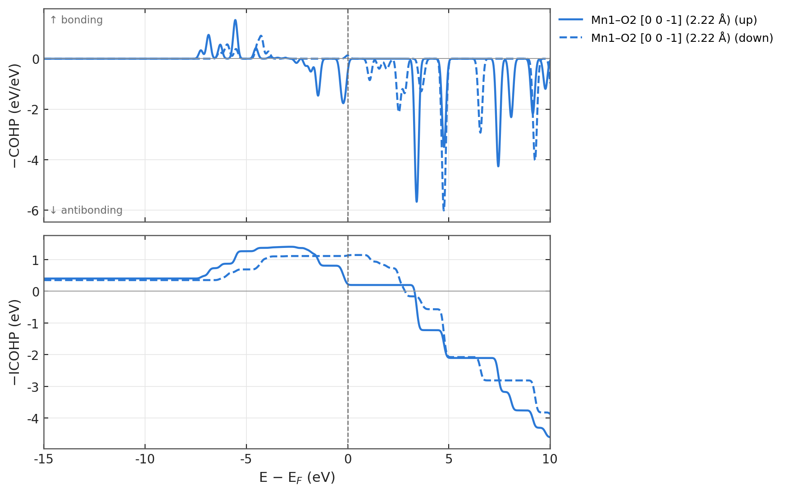
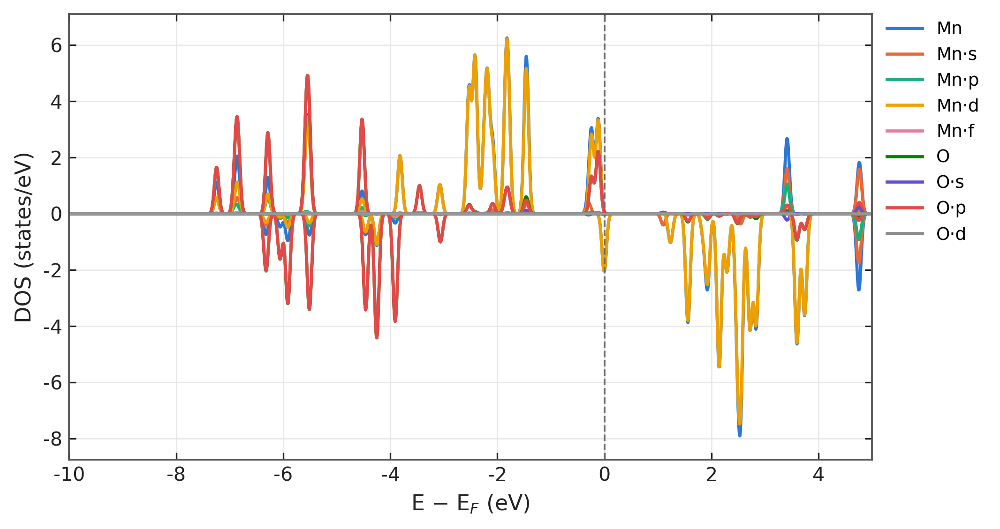

# CP2K BondDOS 使用教程

从一个 CP2K 输入文件开始，到拿到 COHP 曲线、键强表、原子 PDOS、d 带中心和电荷为止的完整流程。教程里的数字都是随软件附带的例子（`examples/cp2k_input/MnO_uks_smear.inp`，铁磁 MnO）在 CP2K 2026.2 上实际算出来的，你可以照着重做一遍核对。

共 11 节：1 安装 · 2 CP2K 计算 · 3 检查数据 · 4 COHP/COOP/COBI · 5 原子 PDOS、能带中心、电荷 · 6 CP2K 自带的 DOS/PDOS · 7 Windows 图形界面 · 8 结果怎么用 · 9 接 pymatgen / LobsterPy · 10 常见问题 · 11 命令速查

---

## 1 安装

软件有两种形态，功能相同：

| 平台 | 形态 | 怎么装 |
|---|---|---|
| Windows | 图形界面 `CP2K_BondDOS.exe`（也带命令行） | 双击 `build_windows.bat` 生成 `dist\CP2K_BondDOS.exe` |
| Linux / macOS / 服务器 | **无界面命令行** | 下面三种方式任选其一 |

Linux 无界面版的三种装法：

```bash
# 方式 A：pip 安装（推荐）。只依赖 numpy 和 matplotlib，装完得到命令 cp2k-bonddos
pip install git+https://github.com/TDChouQ/CP2K_BondDOS

# 方式 B：不安装，直接从源码运行
git clone https://github.com/TDChouQ/CP2K_BondDOS && cd CP2K_BondDOS
pip install -r requirements-cli.txt
python main.py --version            # 之后所有命令写成  python main.py <子命令> ...

# 方式 C：单文件可执行程序（约 35 MB，目标机器不需要 Python）
bash build_linux.sh                 # 生成 dist/cp2k-bonddos，可拷到同类 Linux 机器上直接用
```

下文命令统一写成 `cp2k-bonddos ...`；用方式 B 时换成 `python main.py ...`，Windows 上换成 `CP2K_BondDOS.exe ...`。

没有显示器的机器上不带参数运行会打印帮助；想在 Linux 桌面上用图形界面，再 `pip install PySide6-Essentials` 后运行 `cp2k-bonddos`（不带参数）。

---

## 2 第一步：CP2K 计算

在**结构优化完成后**的单点能输入里改三处。最快的办法是让软件把要加的内容打印出来：

```bash
cp2k-bonddos template --uks --smear --mesh 3 3 3
```

三处分别是（详细说明和“不写会怎样”的实测见 `docs/CP2K输入设置.md`）：

```text
&KPOINTS                         ! ① 只算 Γ 点也必须写（SCHEME GAMMA）
  SCHEME MONKHORST-PACK 3 3 3    !    偶数网格再加一行 GAMMA_CENTERED T
  SYMMETRY F
&END KPOINTS

&SCF                             ! ② 对角化（k 点不能用 OT）+ 空轨道
  ADDED_MOS 20
  &DIAGONALIZATION
  &END DIAGONALIZATION
&END SCF

&PRINT                           ! ③ 放进已有的 &DFT/&PRINT
  &MO_KP ON
    FILENAME ./cohp_mo
    AO_EXPORT_TYPE OVERLAP_MATRIX
    NDIGITS 12
  &END MO_KP
  &KS_CSR_WRITE ON
    FILENAME ./cohp_ks
  &END KS_CSR_WRITE
&END PRINT
```

注意：注释不要写在 `FILENAME` 同一行，CP2K 会把它当成文件名的一部分。

跑附带的例子：

```bash
mkdir mno && cd mno
cp <软件目录>/examples/cp2k_input/* .
mpirun -np 4 cp2k.psmp -i MnO_uks_smear.inp -o MnO_uks_smear.out
```

算完后目录里与 BondDOS 有关的文件：

```text
cohp_mo-1_0.mokp                         k 点、本征值、占据数、MO 系数、S(k)
cohp_ks-KS_SPIN_1_K_1-1_0.csr …          H(k)，每个自旋、每个 k 点一个（本例 2×14 个）
MnO_uks-ALPHA_k1_curve-1.pdos …          CP2K 自带的按 KIND 的 PDOS（k1 = 第 1 种 KIND = Mn）
MnO_uks-curve-1.dos                      CP2K 自带的总 DOS
```

`.mokp` 和全部 `.csr` 必须来自同一次计算并放在同一个文件夹；重算前把旧的删掉。

---

## 3 第二步：检查数据

先写一个配置文件 `cohp_MnO_uks.in`（例子里已有）：

```text
MOKP = cohp_mo-1_0.mokp
KS_DIR = .
BOND = 1 2 ALL ORB           # 1 号和 2 号原子之间所有等距的最近键，并做轨道分解
AUTO_BONDS = 1.5 2.5         # 再自动搜索 1.5–2.5 Å 内的全部键
EMIN_EV = -15
EMAX_EV = 10
OUTPUT_PREFIX = results_MnO_uks/CP2K
```

只检查、不计算：

```bash
cp2k-bonddos cohp cohp_MnO_uks.in --check
```

```text
体系: Mn1 O1  原子 2  AO 39  MO 33  k 点 27 (网格 3×3×3)  自旋 2  H: KS_CSR_WRITE
能量零点: 10.473958 eV (由占据数估计的费米能 (f=1/2))
  [OK] S(k) 厄米性 max|S−S†|: 1.000e-13
  [OK] S(k) 最小本征值: 1.347e-02
  [OK] S(k) 条件数: 5.022e+02
  [OK] MO 归一化 max|C†SC−I|: 8.099e-12
  [OK] 广义本征方程 max|HC−SCε|/max|ε| (Ha): 2.659e-12
  [OK] Tr(PH) − Σwfε (eV): -4.705e-12
  [OK] 电子数 Σ w·f: 2.100e+01
  [OK] 最高导出轨道占据数: 3.230e-311
  [OK] k 网格混叠指标 max|S̃_μμ(0)−1|: 5.108e-05
  相位约定检查: score(+)=204 score(−)=1.85e+03 一致
  警告: k 网格经时间反演约化（14 个 k 点），已…自动展开为完整网格 3×3×3（27 个 k 点）
```

每一项的含义，以及出现 `[!!]` 时该改什么：

| 检查项 | 含义 | 不通过时 |
|---|---|---|
| MO 归一化 | C†SC 应为单位阵 | `NDIGITS` 太小，或 `.mokp` 被截断 |
| 广义本征方程 | HC = SCε | `.csr` 与 `.mokp` 不是同一次计算，删掉旧文件重算 |
| 电子数 | Σ w·f 应等于价电子数 | 文件不完整；可在配置里写 `ELECTRONS = 21` 让它核对 |
| 最高导出轨道占据数 | 应为 0 | `ADDED_MOS` 太少 |
| k 网格混叠指标 | 应远小于 1 | k 网格太粗（小晶胞至少 3×3×3） |
| 相位约定检查 | 应为“一致” | 把报告发给开发者 |

这里的“警告”都是说明性的：CP2K 默认只存一半 k 点，软件已自动展开；O 原子正好在分数坐标 0.5 上，软件已自动判定它的周期镜像归属。

---

## 4 第三步：COHP / COOP / COBI

```bash
cp2k-bonddos cohp cohp_MnO_uks.in --plot
```

```text
COHP 规范: ECOV
   1 Mn1–O2 [0 0 -1]    d=2.2225 Å  COHP=-1.3961  COOP=0.1604  COBI=0.3003  ok
   2 Mn1–O2 [0 -1 0]    d=2.2225 Å  COHP=-1.3971  COOP=0.1604  COBI=0.3003  ok
   …（共 6 根等价的 Mn–O 键）
已写出 19 个文件到 results_MnO_uks
图片 -> results_MnO_uks/CP2K_COHP.png
```

屏幕上的三个数是**积分值**（对占据态求和，两个自旋合计）：ICOHP（eV，越负成键越强）、ICOOP（电子）、ICOBI（键级）。方括号里是 2 号原子所在的晶胞平移，用来区分同一对原子的不同周期镜像。



上图是 `--plot` 直接输出的 `CP2K_COHP.png`：上半幅是 −COHP（正值成键、负值反键），下半幅是它的积分。实线、虚线分别是自旋向上、向下。可以读出：费米能以下 −7 到 −4 eV 是 Mn–O 成键态；自旋向上通道在 −2 到 0 eV 有被占据的反键态（高自旋 d⁵ 的 e_g*），所以向上通道的 ICOHP（−0.27 eV）远小于向下通道（−1.13 eV）。

### 4.1 键的写法

| 写法 | 含义 |
|---|---|
| `BOND = 1 2` | 1 号与 2 号原子最近的那一根键 |
| `BOND = 1 2 ALL` | 所有等距的最近周期镜像（MnO 里是 6 根） |
| `BOND = 1 2 -1 0 0` | 指定晶格平移 |
| `BOND = 1 2 PAIR` | 1–2 之间全部周期镜像合计；Γ 点大超胞只能用这种 |
| 末尾加 `ORB` | 对这根键做轨道分解 |
| `AUTO_BONDS = 1.5 2.5` | 自动搜索该距离范围内的全部键 |
| `AUTO_BONDS = 1.5 2.5 Mn O` | 只搜索 Mn–O 键 |

原子编号就是 CP2K 输入里 `&COORD` 的顺序，从 1 开始。

### 4.2 其他设置

| 关键字 | 默认 | 说明 |
|---|---|---|
| `COHP_BASIS` | `AO` | `LOWDIN` 为正交化表象（ICOHP 数值偏大，只宜定性） |
| `COHP_GAUGE` | `ECOV` | 共价键能规范，不依赖势能零点；`RAW` 为未修正的 H（不推荐） |
| `ORBITAL_RESOLUTION` | `L` | 轨道分解的粒度：`L`（s/p/d）、`LM`（px、dxy…）、`SHELL`、`AO` |
| `FWHM_EV` | 0.2355 | 高斯展宽的半高全宽；只影响曲线，不影响积分值 |
| `EMIN_EV` / `EMAX_EV` / `DE_EV` | −15 / 10 / 0.01 | 曲线的能量范围和步长 |
| `EF_EV` | `auto` | 能量零点：`auto`、`hoco`、`midgap`、`fermi`，或直接写 CP2K 输出里的费米能（eV） |
| `PERIODIC` | `XYZ` | 一般不用改 |
| `LOBSTER_FILES` | `T` | 是否同时写 LOBSTER 格式文件 |

完整示例见 `cohp.in.example`。

### 4.3 输出文件

| 文件 | 内容 | 常用来做什么 |
|---|---|---|
| `*_bonds.csv` | 每根键的键长、各自旋的 ICOHP/ICOOP/ICOBI、状态 | 论文里的键强表 |
| `*_COHP_curves.csv`（COOP、COBI 同） | 每根键的曲线及其积分 | 用 Origin 等重新画图 |
| `*_orbital_integrals.csv` | 带 `ORB` 的键的轨道对贡献 | 看是哪对轨道在成键 |
| `*_charges.csv`、`*_grosspop.csv` | Mulliken/Löwdin 电荷、磁矩、轨道布居 | |
| `*_atom_pdos.csv` | 每个原子按 px、dxy… 分解的 PDOS | |
| `*_report.json` | 所有设置、检查结果、积分值 | 留档，保证可重复 |
| `*_COHP.png` 等 | 加 `--plot` 时输出；对称等价的键只画一根 | 快速查看 |
| `COHPCAR.lobster` 等 9 个 + `POSCAR` | LOBSTER 格式 | 交给 pymatgen / LobsterPy（第 9 节） |

本例的轨道分解（`*_orbital_integrals.csv`，第 1 根键，eV）：

| Mn 轨道 – O 轨道 | 自旋向上 | 自旋向下 |
|---|---|---|
| s – p | −0.174 | −0.031 |
| p – p | −0.119 | +0.009 |
| d – p | **+0.072** | **−0.607** |

Mn 3d–O 2p 在向下通道强成键，在向上通道净反键，这正是高自旋 Mn²⁺ 的图像。

结果表里“状态”一栏：`ok` 正常；`gamma` 该方向只有 1 个 k 点（二维体系的真空方向，正常）；`nyquist` 平移恰为网格一半，R 与 −R 混在一起；`aliased` 平移超出 k 网格能分辨的范围，不计算，需要加密 k 网格。

---

## 5 第四步：原子 PDOS、能带中心、电荷

只需要 `.mokp`，不需要 `.csr`，也**不需要在 CP2K 里把原子拆成单独的 KIND**：

```bash
cp2k-bonddos pdos cohp_mo-1_0.mokp \
    --group "Mn: Mn" --group "O: O" --resolution l \
    --emin -10 --emax 5 \
    --out pdos.csv --stats stats.csv --charges charges.csv --plot pdos.png
```

```text
series                    integral    center    width  occ_center  filling
Mn                         11.4912   -0.2178   3.2053     -2.7958   0.5393
Mn·d                        9.9564   -0.2796   2.9032     -2.5388   0.5584
O                           5.3977   -4.2481   2.6115     -4.7433   0.9377
O·p                         5.4062   -4.1913   2.7130     -4.7548   0.9308
…
```



* `--group "名称: 选择"` 可以写多次。选择可以是元素符号，也可以是原子编号：`--group "表面Mn: 1-4,9"`、`--group "掺杂位旁的O: 17,23"`。不写 `--group` 时每种元素一组。
* `--resolution`：`total`、`l`（s/p/d/f）、`lm`（px、dxy、dz2…）、`shell`（基组壳层）。
* 表中各列（都在 `--emin`/`--emax` 窗口内、相对能量零点、两个自旋合计）：`integral` 态数；`center` 能带中心；`width` 宽度；`occ_center` 零点以下部分的中心；`filling` 填充率。**`Mn·d` 一行的 `center` 就是 d 带中心**（本例 −0.28 eV），`O·p` 一行就是 O 2p 带中心（−4.19 eV）。它们由离散能级精确求和得到，不受展宽影响，但**依赖能量窗口**，报告时要写明窗口。
* `--plot-channels total,d` 让图里只画指定的通道（`d` 会包括 dxy…dx2-y2 五个分量），CSV 和统计表仍包含全部通道。
* `--method lowdin` 换成 Löwdin 投影；`--occupied` 按占据数加权；`--ref` 改能量零点。
* `charges.csv`：本例 Mn +0.781、O −0.781（Mulliken），磁矩 4.679 / 0.094 μ_B，与 CP2K 主输出里的 Mulliken 分析逐位相同。

---

## 6 CP2K 自带的 DOS/PDOS 文件

如果输入里加了 `&DOS`（见 `docs/CP2K输入设置.md` 的可选部分），CP2K 自己会输出按 KIND 的 PDOS。BondDOS 可以直接读这些文件画图、合并、算能带中心：

```bash
# 画图 + 统计（Mn 的两个自旋，总量和 d 分量）
cp2k-bonddos dos MnO_uks-ALPHA_k1_curve-1.pdos MnO_uks-BETA_k1_curve-1.pdos \
    --channels total,d --emin -10 --emax 5 --stats bc.csv --plot kind_pdos.png

# 只要能带中心表
cp2k-bonddos band_center MnO_uks-ALPHA_k1_curve-1.pdos MnO_uks-BETA_k1_curve-1.pdos --emin -10 --emax 5

# 把多个 KIND 的 PDOS 加起来
cp2k-bonddos merge_pdos *_curve-1.pdos            # -> merged_pdos.dat
```

```text
name                 ch   spin    integral     center    width  occ_center  filling
Mn[alpha]             d  alpha      5.0415    -2.4232   1.7746     -2.4684   0.9935
Mn[beta]              d   beta      4.8926     1.8878   2.1672     -3.9001   0.0988
```

α 的 d 带几乎填满（填充率 0.99）、β 的 d 带几乎全空（0.10），即高自旋 d⁵。两个自旋按态数加权平均得 −0.30 eV，与第 5 节由 `.mokp` 算的 −0.28 eV 一致（差别来自两者能量零点相差 0.02 eV 和曲线积分的精度）。

用这类文件要知道的几件事（均为 CP2K 2026.2 实测）：

| 事实 | 影响 |
|---|---|
| 文件名里的 `k1`、`k2` 是 **KIND 编号**，不是 k 点 | 一个文件 = 一种 KIND 的全部原子 |
| k 点计算只输出展宽后的 `_curve` 文件 | 展宽宽度在算 CP2K 时就定了；想换展宽、想要单个原子，用第 5 节的 `pdos` |
| `&LDOS`（按原子列表投影）在 k 点计算里被 CP2K 忽略 | 同上 |
| 闭壳层（RKS）曲线每个轨道只计 1 个态 | 要含两个自旋的强度时加 `--scale 2`；自旋极化计算不用 |
| 自旋极化时两个自旋的费米能可能不同 | CP2K 所有曲线都以较高者为零点，BondDOS 按同样规则处理 |

常用选项：`--ref fermi|hoco|absolute|file` 换能量零点；`--fwhm` 只对 Γ 点计算的逐轨道原始文件（`*-k1-1.pdos`）起作用；`--merge` 把所选文件逐点相加；`--occupied` 只看占据部分。

---

## 7 Windows 图形界面

双击 `CP2K_BondDOS.exe`，左侧六页：

1. **态密度 DOS / PDOS**（对应第 6 节）：导入 `.pdos/.dos` 文件或整个文件夹 → 勾选数据和轨道 → 选能量零点 → 图和统计表自动更新；可合并、导出 CSV 和图片。
2. **k 点成键 COHP**（对应第 3、4 节）：
   1. 选 `.mokp` 和 KS 文件夹 → **读取并检查数据**，看检查项是否全部通过；
   2. 设置表象、“AO-COHP 规范”（保持默认的共价键能 E_cov）、要算的量、展宽、能窗；
   3. 在输入框里写键（写法同 4.1 的表，不带 `BOND =`），点“添加”；或勾选自动搜索；
   4. **开始计算** → 结果表里选一根或多根键看曲线，可求和、看轨道对；
   5. **导出全部结果** 得到 4.3 节的全部文件；“保存配置”得到的 `cohp.in` 可以直接拿到 Linux 上用命令行重算。
3. **电荷与原子 PDOS**（对应第 5 节）：先在第 2 页读入 `.mokp`；原子组每行写 `名称: 选择`。
4. **CP2K 输入设置**、5. **方法说明**、6. **运行日志**。

图的样式（横排/竖排、字号、线宽、填充、尺寸、DPI）在各页的绘图选项里调整，可导出 PNG/PDF/SVG/TIFF。

---

## 8 结果怎么用

**哪些数可以直接比较**

* 同一个体系里不同的键、同一套基组和赝势下的一系列体系（掺杂前后、充放电前后、不同晶面）：ICOHP、ICOBI、ICOOP 都可以比。
* 跨基组、或与 VASP+LOBSTER 的数值比较：只比**趋势**。本软件直接用 CP2K 的 Gaussian 基，LOBSTER 用的是投影到极小基，绝对值不会相同。

**三个量怎么选**

| 量 | 含义 | 建议 |
|---|---|---|
| ICOBI | 键级（单键约 1） | 最稳健，跨体系比较首选 |
| ICOHP（默认 ECOV 规范） | 共价键能贡献，eV | 讨论键强、画 −COHP 曲线 |
| ICOOP | 重叠布居 | 定性判断成键/反键 |

同一基组下的参考值（PBE/DZVP-MOLOPT-SR-GTH）：金刚石 Si–Si 的 ICOHP −4.32 eV、ICOBI 0.95；石墨烯 C–C −10.92 eV、1.25；MnO 的 Mn–O −1.40 eV、0.30。

**必须做的收敛性检查**

* 小晶胞里区分具体某一根键需要多 k 点：换 3×3×3 → 4×4×4（加 `GAMMA_CENTERED T`）→ 5×5×5，看 ICOHP 是否稳定（Si：−4.32 → −4.36 eV）。
* 对称等价的键应给出相同的值；不相同时先看是不是用了不含 Γ 的偶数网格。
* 超过约 100 个原子的体系用 Γ 点 + `PAIR` 模式；超胞足够大时它等于最近那根键的值。

**论文里怎么写**（示例）

> COHP、COBI 由 CP2K 的 Gaussian 原子轨道基下的 Kohn–Sham 矩阵和重叠矩阵直接计算（CP2K BondDOS），其中 COHP 采用共价键能定义 H_μν − ½(ε_μ+ε_ν)S_μν 以消除周期体系势能零点的任意性；积分值用 SCF 占据数对离散态求和得到。

对应文献：Dronskowski & Blöchl, *J. Phys. Chem.* **97**, 8617 (1993)（COHP）；Müller et al., *J. Phys. Chem. C* **125**, 7959 (2021)（COBI）；Börnsen et al., *J. Phys.: Condens. Matter* **11**, L287 (1999)（共价键能）。

---

## 9 接 pymatgen / LobsterPy

导出目录里的 LOBSTER 格式文件已用 pymatgen 2026.10 和 LobsterPy 0.6.1 实际读取验证（自旋极化和非极化都测过）。

```python
from pymatgen.io.lobster import Cohpcar, Icohplist, Charge, Doscar, Grosspop

cohp = Cohpcar(filename="COHPCAR.lobster")
cobi = Cohpcar(filename="COBICAR.lobster", are_cobis=True)
icohp = Icohplist(filename="ICOHPLIST.lobster").icohplist
charge = Charge(filename="CHARGE.lobster").mulliken
dos = Doscar(doscar="DOSCAR.lobster", structure_file="POSCAR").completedos
```

LobsterPy 的自动成键分析：

```python
from lobsterpy.cohp.analyze import Analysis
from lobsterpy.cohp.describe import Description

a = Analysis(path_to_poscar="POSCAR", path_to_icohplist="ICOHPLIST.lobster",
             path_to_cohpcar="COHPCAR.lobster", path_to_charge="CHARGE.lobster",
             which_bonds="cation-anion", cutoff_icohp=0.1)
d = Description(analysis_object=a)
print(" ".join(d.text))
d.plot_cohps(save=True, filename="lobsterpy_cohp.png", hide=True)
```

本例的输出：

```text
The compound MnO has 1 symmetry-independent cation(s) with relevant cation-anion interactions: Mn1.
Mn1 has an octahedral (CN=6) coordination environment. It has 6 Mn-O (mean ICOHP: -1.4 eV, …) bonds.
```

要点：

* LobsterPy 靠 `ICOHPLIST` 里的键来判断配位环境，所以导出前要用 `AUTO_BONDS` 把第一配位层的键都算上（只写一根 `BOND` 它会认为配位数是 1）。
* 换成 COBI：`path_to_icohplist="ICOBILIST.lobster", path_to_cohpcar="COBICAR.lobster", are_cobis=True`。
* `PAIR` 模式的键不写入 LOBSTER 文件。
* 这些文件首行都注明数据来自 CP2K 的 Gaussian 基，不是 LOBSTER 的投影结果。

---

## 10 常见问题

| 现象 | 原因和处理 |
|---|---|
| 找不到 `.mokp` | CP2K 输入里没有 `&KPOINTS`（Γ 点也要写 `SCHEME GAMMA`）或没有 `&MO_KP` |
| 提示没有 S(k)，COOP/COBI/电荷不可用 | `&MO_KP` 里没写 `AO_EXPORT_TYPE OVERLAP_MATRIX` |
| 提示没有 KS 文件，COHP 不可用 | 没加 `&KS_CSR_WRITE`，或 `.csr` 不在 `KS_DIR` 指的文件夹里 |
| “广义本征方程”不通过 | `.csr` 与 `.mokp` 不是同一次计算 |
| “最高导出轨道占据数”不通过，或曲线在费米能上方突然截断 | 增大 `ADDED_MOS` |
| 键的状态是 `aliased`，数值为 0 | 这根键超出当前 k 网格能分辨的范围；加密 k 网格，或改用 `PAIR` |
| 提示“k 网格经过点群对称性约化” | CP2K 里用了 `SYMMETRY T`，改回 `SYMMETRY F` 重算 |
| 对称等价的键数值略有不同 | 偶数 k 网格没加 `GAMMA_CENTERED T`；或 SCF 没收敛到对称的态（差别在 10⁻³ eV 量级时可忽略） |
| ICOHP 是正的，或大得离谱 | 用了 `COHP_GAUGE = RAW` 或 `COHP_BASIS = LOWDIN`；改回默认 |
| 文件名变成 `cohp_mo!…` | CP2K 输入里把注释写在了 `FILENAME` 同一行 |
| 一个文件夹里有好几套 `-1_0`、`-1_1` 文件 | 在结构优化过程中开了输出；选最后一个 `.mokp`，软件会自动匹配对应的 `.csr` |
| CP2K 在 SCF 第一步就段错误（`elpa_autotune`） | conda-forge 版 CP2K 的 ELPA 在实数对角化（不写 `&KPOINTS` 的 Γ 点计算）时的问题；`&GLOBAL` 里加 `PREFERRED_DIAG_LIBRARY SCALAPACK` |
| 文件太大、读得慢 | 减小 `ADDED_MOS`；大体系用 Γ 点；只要 PDOS/电荷时可以不输出 `.csr` |
| Linux 上图里的中文显示成方块 | 只影响图例里的中文组名；`--group` 用英文名，或安装 Noto Sans CJK 字体 |

---

## 11 命令速查

```bash
cp2k-bonddos template [--uks] [--smear] [--mesh N N N] [--added-mos N]   # 打印 CP2K 输入要加的内容
cp2k-bonddos cohp cohp.in --check                                         # 只检查数据
cp2k-bonddos cohp cohp.in [--plot]                                        # COHP/COOP/COBI + 全部导出
cp2k-bonddos pdos x.mokp [--group "名称: 选择"]... [--resolution l|lm|shell|total]
                         [--method mulliken|lowdin] [--emin E --emax E] [--ref auto|…]
                         [--out a.csv] [--stats s.csv] [--charges q.csv] [--plot p.png] [--plot-channels total,d]
cp2k-bonddos dos *.pdos [--channels total,d] [--ref fermi|hoco|absolute|file] [--merge]
                        [--scale 2] [--emin E --emax E] [--out c.csv] [--stats s.csv] [--plot p.png]
cp2k-bonddos band_center *.pdos [--emin E --emax E]                       # -> band_center.dat
cp2k-bonddos merge_pdos *.pdos                                            # -> merged_pdos.dat
cp2k-bonddos demo <文件夹>                                                 # 生成合成演示数据（不是 CP2K 结果）
cp2k-bonddos --version
```

相关文档：`docs/CP2K输入设置.md`（CP2K 端每个关键字的实测说明）、`docs/方法说明.md`（公式、约定和验证）。
